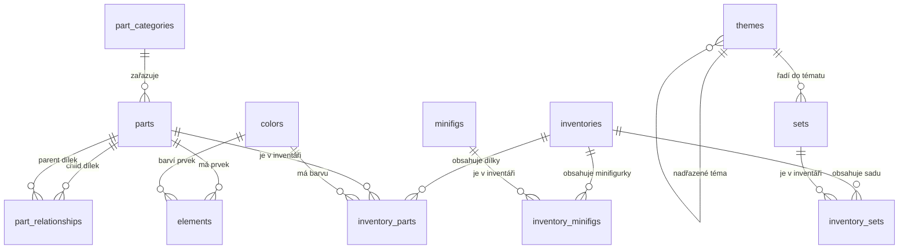

# LEGO databáze – průvodce pro studenty

Tento dokument představuje databázi LEGO uloženou ve schématu `lego`.

Databáze obsahuje informace o LEGO dílcích, barvách, sadách, minifigurkách a o tom, co se nachází v jednotlivých inventářích. Nejde o jednu velkou tabulku: údaje jsou rozdělené do menších tabulek a propojené pomocí klíčů.

## 1. Základní pojmy

- **Tabulka** uchovává jeden druh informací. Například `parts` obsahuje dílky.
- **Řádek** je jeden záznam v tabulce, třeba jeden konkrétní dílek.
- **Primární klíč (PK)** jednoznačně identifikuje řádek. Například `parts.part_num` označuje dílek.
- **Cizí klíč (FK)** odkazuje na primární klíč v jiné tabulce. Zajišťuje, že odkazovaný záznam existuje.
- **Vazba 1:N** znamená, že jeden záznam může souviset s mnoha záznamy v jiné tabulce. Například jedna kategorie může mít mnoho dílků.
- **Spojovací tabulka** propojuje záznamy z více tabulek a často vyjadřuje vazbu N:M. Například jeden inventář obsahuje mnoho dílků a stejný dílek se může objevit v mnoha inventářích.

Názvy tabulek a sloupců jsou anglicky, protože tak jsou pojmenované v dodaných datech.

## 2. Přehled tabulek

### Základní katalogy

| Tabulka | Co obsahuje | Hlavní klíč | Ukázky skutečných hodnot z databáze |
|---|---|---|---|
| `part_categories` | Kategorie dílků | `id` | `11` — Bricks; `3` — Bricks Sloped; `1` — Baseplates |
| `colors` | Barvy, jejich RGB hodnoty a další údaje | `id` | `1` — Blue; `2` — Green; `4` — Red |
| `themes` | Témata LEGO sad; některá témata mají nadřazené téma | `id` | `1` — Technic; `18` — Star Wars; `3` — Competition |
| `parts` | Katalog LEGO dílků a jejich kategorie | `part_num` | `3001` — Brick 2 x 4; `30144` — Brick 2 x 4 x 3 |
| `minifigs` | Katalog minifigurek | `fig_num` | `fig-000001` — Toy Store Employee; `fig-000005` — Captain America with Short Legs |
| `sets` | Katalog LEGO sad, jejich rok a téma | `set_num` | `10179-1` — Millennium Falcon; `4488-1` — Millennium Falcon |
| `elements` | Konkrétní prvek spojený s dílkem a barvou | `element_id` | `15254` — prvek dílku `15254` v barvě s ID `85` |
| `part_relationships` | Vztahy mezi dílky, například náhrady či související díly | kombinace `rel_type`, `child_part_num`, `parent_part_num` | `A`, dílek `10111843` → dílek `10120456` |

### Tabulky inventářů a jejich obsahu

| Tabulka | Co obsahuje | Hlavní klíč | Ukázky skutečných hodnot z databáze |
|---|---|---|---|
| `inventories` | Verze inventáře identifikovaná číslem `id` | `id` | inventář `1`: sada `7922-1`, verze `1`; inventář `3`: sada `3931-1`, verze `1` |
| `inventory_parts` | Počet konkrétních dílků a barev v inventáři; rozlišuje i náhradní dílky | `inventory_id`, `part_num`, `color_id`, `is_spare` | inventář `1`, dílek `48379c04`, barva `72`, nenáhradní (`false`), počet `1` |
| `inventory_minifigs` | Minifigurky obsažené v inventáři a jejich počet | `inventory_id`, `fig_num` | inventář `3`, minifigurka `fig-001549`, počet `1` |
| `inventory_sets` | LEGO sady obsažené jako podčásti daného inventáře | `inventory_id`, `set_num` | inventář `35`, sada `75911-1`, počet `1` |

Ukázky jsou vybrané ze skutečných řádků databáze. Čísla za názvy jako `Blue` nebo `Bricks` jsou skutečné hodnoty primárního klíče; název pomáhá člověku záznam poznat. U tabulek, kde je primárním klíčem kód, například `part_num` nebo `set_num`, je ukázaný právě tento kód.

Názvy nejsou vždy jedinečné — například v tabulce sad jsou dvě různé sady pojmenované `Millennium Falcon`. Proto se při spojování tabulek používá primární klíč (`set_num`), ne samotný název.

Složený klíč tvoří více sloupců dohromady. Například v `inventory_parts` může být stejný dílek v jednom inventáři přítomen jako běžný i jako náhradní; proto je součástí klíče také `is_spare`.

## 3. Jak jsou tabulky propojené



Diagram ukazuje vazby vynucované cizími klíči. Například `parts.part_cat_id` odkazuje na `part_categories.id`, takže každý dílek musí mít existující kategorii.

### Proč není přímá vazba `inventories` → `sets`?

Sloupec `inventories.set_num` vypadá, že by mohl odkazovat na `sets.set_num`, ale ne všechny jeho hodnoty označují LEGO sadu. Část inventářů patří minifigurkám a používá hodnoty začínající například `fig-`. Při kontrole dat 17 223 řádků v `inventories` nemělo odpovídající `set_num` v tabulce `sets`.

Proto zde přímý cizí klíč není. Jeho přidání by selhalo při kontrole existujících dat a navíc by nesprávně zakázalo některé inventáře minifigurek. Vazba z inventáře na obsažené sady je místo toho vyjádřena tabulkou `inventory_sets`.

## 4. Důležité vazby podrobněji

### Dílky a kategorie

- `parts.part_cat_id` → `part_categories.id`
- Jedna kategorie může obsahovat mnoho dílků.
- Každý dílek patří do jedné kategorie.

### Dílky, barvy a inventáře

- `inventory_parts.inventory_id` → `inventories.id`
- `inventory_parts.part_num` → `parts.part_num`
- `inventory_parts.color_id` → `colors.id`
- Jeden řádek v `inventory_parts` popisuje konkrétní kombinaci inventáře, dílku, barvy a příznaku náhradního dílku.

### Inventáře, sady a minifigurky

- `inventory_minifigs` propojuje inventáře s katalogem `minifigs` a ukládá množství.
- `inventory_sets` propojuje inventáře s katalogem `sets` a ukládá množství.
- Obě tabulky jsou spojovací tabulky: stejná minifigurka nebo sada se může objevit v mnoha inventářích.

### Témata

- `sets.theme_id` → `themes.id`
- `themes.parent_id` → `themes.id`
- Téma tedy může mít nadřazené téma. Jde o příklad vazby tabulky na sebe samu.

## 5. Příklad: jak je v databázi uložen set Millennium Falcon

Podíváme se na skutečný set `10179-1`, pojmenovaný **Millennium Falcon**. Je to dobrý příklad, protože databáze ukládá obecné údaje o sadě zvlášť od podrobného seznamu jejího obsahu.

### Základní údaje o sadě

V tabulce `sets` je jeden řádek pro tento set:

| Sloupec | Hodnota | Význam |
|---|---|---|
| `set_num` | `10179-1` | Jedinečný identifikátor sady a primární klíč |
| `name` | Millennium Falcon | Název sady |
| `year` | `2007` | Rok vydání uvedený v katalogu |
| `num_parts` | `5198` | Počet dílků evidovaný v katalogu |
| `theme_id` | `171` | Odkaz na téma v tabulce `themes` |

Řádek s `theme_id = 171` se spojí s `themes.id = 171`; název tématu je **Ultimate Collector Series**. Téma se neukládá znovu textem u každé sady — sada uchovává jeho ID a cizí klíč odkazuje na příslušný řádek.

### Inventář konkrétní verze

Podrobné složení je navázáno přes tabulku `inventories`. Pro tuto sadu je v databázi inventář `id = 6409`, `set_num = 10179-1`, `version = 1`. Tabulka `sets` tedy říká, **která sada existuje**, a `inventories` určuje, **kterou verzi jejího obsahu** právě popisujeme.

### Jak databáze popisuje dílky

Každý řádek v `inventory_parts` spojuje inventář, dílek a barvu a ukládá počet kusů. Například skutečný řádek pro tuto sadu je:

| `inventory_id` | `part_num` | `color_id` | `is_spare` | `quantity` |
|---:|---|---:|---|---:|
| 6409 | `3021` | 71 | `false` | 243 |

Samotný řádek neobsahuje texty „Plate 2 x 3“ ani „Light Bluish Gray“. Ty se získají přes klíče:

- `part_num = 3021` odkazuje do `parts`, kde je název **Plate 2 x 3**;
- `color_id = 71` odkazuje do `colors`, kde je barva **Light Bluish Gray**;
- `is_spare = false` znamená, že nejde o náhradní dílek;
- `quantity = 243` říká, že inventář obsahuje 243 takových kusů.

V inventáři této verze je 281 řádků s kombinací dílku, barvy a příznaku náhradního dílku, které pokrývají 231 různých čísel dílků. Součet `quantity` je 5 200 kusů, z toho 21 náhradních. Číslo `sets.num_parts` je samostatný katalogový údaj; nemusí se přesně rovnat součtu obsahu inventáře, protože jde o údaje z různých polí a evidencí.

### Minifigurky

Minifigurky nejsou zapsané jako běžné dílky. Propojuje je tabulka `inventory_minifigs`, která obsahuje ID inventáře, identifikátor minifigurky a její množství. Inventář `6409` uvádí pět minifigurek, po jedné od každé: Han Solo (`fig-003817`), Chewbacca (`fig-000124`), Luke Skywalker (`fig-003952`), Obi-Wan Kenobi (`fig-003953`) a Princess Leia (`fig-002688`). Jejich podrobné názvy jsou v tabulce `minifigs`.

### Cesta mezi tabulkami

```text
sets (set_num = 10179-1)
  └─ inventories (id = 6409, version = 1)
       ├─ inventory_parts ── parts (např. dílek 3021)
       │                  └─ colors (např. barva 71)
       └─ inventory_minifigs ── minifigs (např. fig-003817)
```

### SQL, které ukáže obsah inventáře

Následující dotaz spojí řádky z inventáře s názvy dílků a barev. Výsledek tedy ukazuje čitelný popis, i když tabulka `inventory_parts` ukládá hlavně jejich identifikátory.

```sql
SELECT
    ip.part_num,
    p.name AS part_name,
    c.name AS color_name,
    ip.quantity,
    ip.is_spare
FROM lego.inventory_parts AS ip
JOIN lego.parts AS p
    ON p.part_num = ip.part_num
JOIN lego.colors AS c
    ON c.id = ip.color_id
WHERE ip.inventory_id = 6409
ORDER BY ip.is_spare, ip.quantity DESC
LIMIT 10;
```

Podobně lze zobrazit minifigurky daného inventáře:

```sql
SELECT
    f.fig_num,
    f.name,
    im.quantity
FROM lego.inventory_minifigs AS im
JOIN lego.minifigs AS f
    ON f.fig_num = im.fig_num
WHERE im.inventory_id = 6409;
```

## 6. Ukázkové dotazy

Před názvy tabulek používáme `lego.`, aby bylo jasné, že tabulky patří do schématu `lego`.

### Sady včetně názvu tématu

```sql
SELECT
    s.set_num,
    s.name AS set_name,
    s.year,
    t.name AS theme_name
FROM lego.sets AS s
LEFT JOIN lego.themes AS t
    ON t.id = s.theme_id
ORDER BY s.year DESC
LIMIT 10;
```

`LEFT JOIN` ponechá ve výsledku i sadu, která nemá vyplněné téma.

### Dílky včetně názvu kategorie

```sql
SELECT
    p.part_num,
    p.name AS part_name,
    pc.name AS category_name
FROM lego.parts AS p
JOIN lego.part_categories AS pc
    ON pc.id = p.part_cat_id
ORDER BY p.part_num
LIMIT 10;
```

### Obsah jednoho inventáře

Nahraďte `1` číslem existujícího inventáře.

```sql
SELECT
    i.id AS inventory_id,
    i.set_num,
    p.part_num,
    p.name AS part_name,
    c.name AS color_name,
    ip.quantity,
    ip.is_spare
FROM lego.inventories AS i
JOIN lego.inventory_parts AS ip
    ON ip.inventory_id = i.id
JOIN lego.parts AS p
    ON p.part_num = ip.part_num
JOIN lego.colors AS c
    ON c.id = ip.color_id
WHERE i.id = 1
ORDER BY p.name, c.name;
```

Pokud dotaz nic nevrátí, číslo inventáře `1` v databázi nemusí být dostupné; zkuste jiné `inventory_id`.

## 7. Na co si dát pozor

1. **Sada, dílek a inventář jsou různé věci.** `sets` je katalog sad, zatímco `inventories` popisuje jejich konkrétní inventáře a verze.
2. **Počty kusů jsou v tabulkách obsahu.** Například počet dílků v inventáři je v `inventory_parts.quantity`, nikoli v samotné tabulce `parts`.
3. **Identifikátory nejsou vždy čísla.** `part_num`, `set_num` i `fig_num` jsou textové hodnoty; mohou obsahovat písmena, pomlčky nebo počáteční nuly.
4. **Ne každé propojení, které vypadá logicky, je databázovým cizím klíčem.** Diagram zobrazuje skutečné omezení `FOREIGN KEY`, ne jen podobně pojmenované sloupce.
5. **Schéma `lego` je jmenný prostor.** Tabulka se v SQL dá zapsat jako `lego.parts`. Díky tomu se odliší od případné tabulky `parts` v jiném schématu.

## 8. Velikost načtených dat

Při kontrole po importu měly hlavní tabulky přibližně tyto počty řádků:

| Tabulka | Počet řádků |
|---|---:|
| `part_categories` | 76 |
| `colors` | 275 |
| `themes` | 496 |
| `parts` | 64 580 |
| `elements` | 114 141 |
| `part_relationships` | 37 388 |
| `minifigs` | 17 223 |
| `sets` | 28 179 |
| `inventories` | 47 338 |
| `inventory_parts` | 1 556 893 |
| `inventory_minifigs` | 25 809 |
| `inventory_sets` | 5 210 |

Počty jsou orientační snímek při importu; mohou se změnit, pokud se data později upraví.
