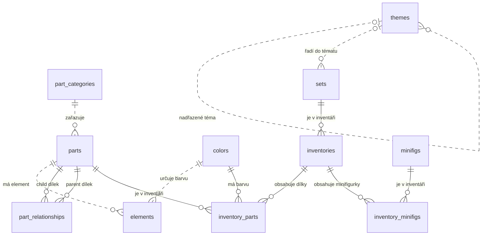

# LEGO databáze – průvodce pro studenty

Databáze ve schématu `lego` obsahuje katalog dílků, barev, sad a minifigurek a seznamy jejich obsahu. SQL ukázky používají PostgreSQL.

### Rebrickable: k čemu tato data slouží v praxi

Na [Rebrickable](https://rebrickable.com/) lze prohlížet dílky, jejich varianty a obsah sad. Po zadání vlastní sbírky aplikace vyhledá modely, které z ní můžete postavit. Vedle oficiálních sad nabízí i modely uživatelů označované **MOC** (*My Own Creation*).

- [Katalog dílků](https://rebrickable.com/parts/) — vyhledejte například dílek `3001` (Brick 2 x 4), otevřete jeho detail a prohlédněte si dostupné barvy, související dílky a sady, ve kterých se objevuje.
- [Katalog sad](https://rebrickable.com/sets/) — vyhledejte sadu `10179-1` (Millennium Falcon) a porovnejte její inventář s příkladem v kapitole 5.
- [Dokumentace katalogových dat a soubory ke stažení](https://rebrickable.com/downloads/) — najdete zde CSV soubory pro import a popis jejich struktury, včetně kódů vztahů mezi dílky.
- [Nápověda k hledání modelů ze sbírky](https://rebrickable.com/help/build-engine/) — ukazuje, jak aplikace porovnává požadované dílky s dostupnou sbírkou. Pro evidenci vlastní sbírky je potřeba účet.

Databáze ve cvičení je snímkem CSV exportu oficiálního katalogu; neobsahuje modely MOC ani osobní sbírky. Aktuální webový katalog se může od importu lišit.

## 1. Co databáze eviduje

- **Dílek** je katalogový typ, například kostka 2 × 4 (`3001`), nikoli jeden fyzický kus. Barva a množství se evidují zvlášť.
- **Sada** je stavebnice s vlastním katalogovým číslem, například `10179-1`.
- **Inventář** je seznam obsahu sady nebo minifigurky v určité verzi. Nejde o osobní sbírku uživatele.

## 2. Přehled tabulek

### Základní katalogy

| Tabulka | Co obsahuje | Hlavní klíč | Ukázky skutečných hodnot z databáze |
|---|---|---|---|
| `part_categories` | Kategorie dílků | `id` | `11` — Bricks; `3` — Bricks Sloped; `1` — Baseplates |
| `colors` | Barvy, jejich RGB hodnoty a další údaje | `id` | `1` — Blue; `2` — Green; `4` — Red |
| `themes` | Témata LEGO sad; některá témata mají nadřazené téma | `id` | `1` — Technic; `18` — Star Wars; `3` — Competition |
| `parts` | Katalog LEGO dílků a jejich kategorie | `part_num` | `3001` — Brick 2 x 4; `30144` — Brick 2 x 4 x 3 |
| `minifigs` | Katalog minifigurek | `fig_num` | `fig-000001` — Toy Store Employee; `fig-000005` — Captain America with Short Legs |
| `sets` | Katalog LEGO sad, jejich rok a téma | `set_num` | `10179-1` — Millennium Falcon; `4488-1` — Millennium Falcon |
| `elements` | Katalogové identifikátory elementů, navázané na dílek a barvu | `element_id` | `15254` — element dílku `15254` v barvě s ID `85` (Dark Purple) |
| `part_relationships` | Vztahy mezi dílky, například náhrady či související díly | kombinace `rel_type`, `child_part_num`, `parent_part_num` | `A`, dílek `10111843` → dílek `10120456` |

### Tabulky inventářů a jejich obsahu

| Tabulka | Co obsahuje | Hlavní klíč | Ukázky skutečných hodnot z databáze |
|---|---|---|---|
| `inventories` | Inventáře sad i minifigurek a jejich verze | `id` | inventář `1`: sada `7922-1`, verze `1`; inventář `3`: sada `3931-1`, verze `1` |
| `inventory_parts` | Počet kusů dílku v dané barvě; rozlišuje běžné a rezervní kusy | `inventory_id`, `part_num`, `color_id`, `is_spare` | inventář `1`, dílek `48379c04`, barva `72`, běžný (`false`), počet `1` |
| `inventory_minifigs` | Minifigurky obsažené v inventáři a jejich počet | `inventory_id`, `fig_num` | inventář `3`, minifigurka `fig-001549`, počet `1` |
| `inventory_sets` | LEGO sady obsažené jako podčásti daného inventáře | `inventory_id`, `set_num` | inventář `35`, sada `75911-1`, počet `1` |

Názvy nejsou jedinečné: sady `10179-1` a `4488-1` se obě jmenují `Millennium Falcon`.

V `inventory_parts` může být stejný dílek ve stejné barvě evidován jako běžný i rezervní, proto je `is_spare` součástí primárního klíče. Rezervní kus (*spare*) je přibalený navíc; není to alternativní typ dílku z `part_relationships`.

**Tabulku `inventory_sets` ve výuce ignorujeme.** Popisuje, které sady (krabice) mohou být součástí jiných sad, tedy vnořování sad do sad. Řešení takto vnořeného obsahu by do cvičení přineslo složitost, kterou v tomto kurzu řešit nechceme. Dále v textu proto tuto tabulku i její vazby zmiňujeme jen informativně, aby bylo jasné, proč se v diagramu ani v dotazech neobjevuje.

## 3. Jak jsou tabulky propojené



Diagram ukazuje vazby vynucované cizími klíči. `||` znamená právě jeden záznam, `|o` na levém konci (nebo `o|` na pravém) žádný nebo jeden a `o{` na pravém konci žádný až mnoho záznamů. Plná čára označuje vazbu, jejíž cizí klíč je součástí primárního klíče navázané tabulky; přerušovaná čára vazbu, u níž tomu tak není.

Každý dílek musí mít kategorii (`parts.part_cat_id NOT NULL`). Odkazy `sets.theme_id` a `themes.parent_id` jsou nepovinné: sada nemusí mít téma a kořenové téma nemá rodiče.

### Proč není přímá vazba `inventories` → `sets`?

Navzdory názvu obsahuje `inventories.set_num` číslo sady **nebo minifigurky**. V importu patří 17 223 inventářů minifigurkám. Cizí klíč pouze do `sets` by tyto záznamy odmítl; vazba na žádný z obou katalogů proto není vynucována.

Inventáře dohledáváme podle:

- `inventories.set_num = sets.set_num` pro sady;
- `inventories.set_num = minifigs.fig_num` pro minifigurky.

`inventory_sets` naopak eviduje sady **uvnitř inventáře**, nikoli sadu, které inventář patří. Inventář `35` například patří sadě `5004559-1` a obsahuje po jednom kusu sad `75911-1` a `75912-1`. Tuto tabulku i vazbu ale ve výuce ignorujeme (viz kapitola 2) — proto se v ER diagramu výše neobjevuje.

## 4. Důležité vazby podrobněji

### Dílky a kategorie

- `parts.part_cat_id` → `part_categories.id`
- Jedna kategorie může obsahovat mnoho dílků.
- Každý dílek patří do jedné kategorie.

### Dílky, barvy a inventáře

- `inventory_parts.inventory_id` → `inventories.id`
- `inventory_parts.part_num` → `parts.part_num`
- `inventory_parts.color_id` → `colors.id`
- Jeden řádek v `inventory_parts` popisuje konkrétní kombinaci inventáře, dílku, barvy a příznaku rezervního kusu. Počet fyzických kusů je v `quantity`.

### Dílky a elementy: proč existují dvě tabulky

`parts.part_num` označuje dílek bez určení barvy. `elements.element_id` označuje katalogový element a odkazuje na dílek i barvu; není to výrobní číslo fyzického kusu. Stejná kombinace dílku a barvy může mít více `element_id`.

**Žádná jiná tabulka na `element_id` neodkazuje.** Například `inventory_parts` ukládá přímo `part_num` a `color_id`, nikoli `element_id`.

`elements` je tedy doplňkový katalog: z elementového kódu umožňuje dohledat dílek a jeho barvu, ale pro zjištění obsahu sady není potřeba.

### Vztahy mezi dílky: `part_relationships`

Tabulka `part_relationships` propojuje **dva záznamy ze stejného katalogu `parts`**. Slouží například k dohledání potištěných variant základního dílku, alternativního provedení nebo součástí sestaveného dílu.

| Sloupec | Význam |
|---|---|
| `rel_type` | Jednopísmenný kód určující druh vztahu |
| `child_part_num` | Číslo dílku v roli `child`; cizí klíč do `parts.part_num` |
| `parent_part_num` | Číslo dílku v roli `parent`; také cizí klíč do `parts.part_num` |

Význam rolí `child` a `parent` závisí na typu vztahu: může jít o variantu a základní dílek, součást a celek nebo dva párové dílky.

#### Jednotlivé hodnoty `rel_type`

Kódy podle [dokumentace Rebrickable](https://rebrickable.com/downloads/), s příklady z importu:

| Kód | Název v Rebrickable | Význam | Ověřený příklad `child` → `parent` |
|---|---|---|---|
| `A` | Alternate | Alternativní provedení evidované katalogem; případná použitelnost jako náhrady závisí na konkrétním modelu. | `10111843` → `10120456`: původní chybný arch samolepek pro sadu `10356-1` → opravený arch. |
| `B` | Sub-Part | Dílčí součást celku, například sestaveného dílu nebo archu s oddělitelnými díly. | `100392a` → `100392`: jeden díl ve tvaru oblaku → kompletní arch s oblaky. |
| `M` | Mold | Varianta výlisku, tedy odlišné konstrukční či tvarové provedení dílku. | `3001a` → `3001`: kostka 2 × 4 bez příčných výztuh → základní katalogová kostka 2 × 4. |
| `P` | Print | Potištěná varianta základního dílku. | `10049pr0001` → `10049`: štít s potištěným otiskem ruky → základní štít. |
| `R` | Pair | Párové propojení souvisejících dílků, například levého a pravého protějšku; nemusí jít o variantu základního dílku. | `10063` → `10061`: pravá paže velké figurky → levá paže. |
| `T` | Pattern | Vzorová varianta dílku, kterou katalog rozlišuje od vztahu Print. Samotný kód neurčuje obecně technologii výroby dekorace. | `102264pat0001` → `102264`: santovská čepice s červeným vrškem označeným Pattern → základní čepice bez vzoru. |

`T` znamená Pattern, nikoli automaticky „samolepka“; rozhodující je popis konkrétního dílku.

Vztahy neurčují barvu ani množství a nezaručují zaměnitelnost. Levý a pravý dílek například tvoří pár, ale nelze je libovolně nahradit. Obrácené ani navazující vztahy se automaticky nedoplňují.

Primární klíč tvoří `rel_type`, `child_part_num`, `parent_part_num`: stejná dvojice může mít více typů vztahu.

#### Jak si vztahy prohlédnout pomocí SQL

Počty vztahů podle typu:

```sql
SELECT
    rel_type,
    COUNT(*) AS relationship_count
FROM lego.part_relationships
GROUP BY rel_type
ORDER BY rel_type;
```

Názvy obou dílků získáme dvojím připojením `parts`:

```sql
SELECT
    pr.rel_type,
    pr.child_part_num,
    child.name AS child_part_name,
    pr.parent_part_num,
    parent.name AS parent_part_name
FROM lego.part_relationships AS pr
JOIN lego.parts AS child
    ON child.part_num = pr.child_part_num
JOIN lego.parts AS parent
    ON parent.part_num = pr.parent_part_num
ORDER BY pr.rel_type, pr.parent_part_num, pr.child_part_num
LIMIT 20;
```

Prvních 20 řádků v tomto importu obsahuje pouze typ `A`. Pro potištěné varianty vložte před `ORDER BY` filtr `WHERE pr.rel_type = 'P'`. Při hledání vztahů jednoho dílku prohledejte oba sloupce.

Dvojici můžete porovnat podle fotografií v [katalogu Rebrickable](https://rebrickable.com/parts/).

### Inventáře, sady a minifigurky

- `inventory_minifigs` propojuje inventáře s katalogem `minifigs` a ukládá množství.
- `inventory_sets` propojuje inventáře s katalogem `sets` a ukládá množství (sady vnořené v jiných sadách). Tuto tabulku ve výuce ignorujeme.

#### Proč je `set_num` v `inventories` i v `inventory_sets`?

Sloupce mají odlišný význam:

- `inventories.set_num` označuje sadu, **jejíž obsah inventář popisuje**. Jedna sada může mít více inventářů, například různé verze. U minifigurek obsahuje tento sloupec místo čísla sady hodnotu `fig_num`.
- `inventory_sets.set_num` označuje sadu, která je **obsažena uvnitř** inventáře uvedeného v `inventory_sets.inventory_id`. Sloupec `quantity` udává počet takto obsažených sad.

Proto pro součet dílků samotné sady vedeme cestu přes `inventories` a `inventory_parts`:

```sql
SELECT
    s.set_num,
    i.id AS inventory_id,
    SUM(ip.quantity) AS piece_count
FROM lego.sets AS s
JOIN lego.inventories AS i
    ON i.set_num = s.set_num
JOIN lego.inventory_parts AS ip
    ON ip.inventory_id = i.id
GROUP BY s.set_num, i.id;
```

`inventory_sets` použijeme naopak, když hledáme celé sady vložené do inventáře. V takovém spojení je `inventory_sets.set_num` číslem **vložené** sady a `inventory_sets.quantity` jejím množstvím; není to spojení inventáře s jeho vlastní sadou.

### Témata

- `sets.theme_id` → `themes.id`
- `themes.parent_id` → `themes.id`
- Kořenová témata mají `parent_id IS NULL`; ostatní odkazují na nadřazené téma.

### Jak vazby ovlivňují mazání

- Tři vazby z tabulek obsahu na `inventories.id` mají `ON DELETE CASCADE`. Smazání inventáře tedy smaže jeho řádky v `inventory_parts`, `inventory_minifigs` a `inventory_sets` (tu ale ve výuce ignorujeme), nikoli samotné katalogové dílky, minifigurky nebo sady.
- `themes.parent_id` má `ON DELETE SET NULL`. Při smazání nadřazeného tématu se u jeho podtémat zruší odkaz na rodiče; podtémata se nemažou. Pokud na mazané téma odkazují sady přes `sets.theme_id`, tato jiná vazba může smazání zablokovat.
- Ostatní cizí klíče používají výchozí `NO ACTION`: odkazovaný záznam nelze smazat, pokud by tím vznikl neplatný odkaz. Proto nelze například bez vyřešení navázaných řádků smazat používaný katalogový dílek.

## 5. Příklad: jak je v databázi uložena sada Millennium Falcon

### Základní údaje o sadě

Sada `10179-1` má v `sets` tyto údaje:

| Sloupec | Hodnota | Význam |
|---|---|---|
| `set_num` | `10179-1` | Jedinečný identifikátor sady a primární klíč |
| `name` | Millennium Falcon | Název sady |
| `year` | `2007` | Rok vydání uvedený v katalogu |
| `num_parts` | `5198` | Počet dílků evidovaný v katalogu |
| `theme_id` | `171` | Odkaz na téma v tabulce `themes` |

Téma `171` je **Ultimate Collector Series**.

### Inventář konkrétní verze

Sadě patří inventář `6409`, verze `1`:

```sql
SELECT
    i.id AS inventory_id,
    i.version,
    s.set_num,
    s.name AS set_name
FROM lego.sets AS s
JOIN lego.inventories AS i
    ON i.set_num = s.set_num
WHERE s.set_num = '10179-1'
ORDER BY i.version, i.id;
```

Sada může mít více verzí inventáře. Pro výpis nebo součet obsahu vyberte jednu, jinak můžete obsah započítat opakovaně.

### Jak databáze popisuje dílky

Příklad řádku z `inventory_parts`:

| `inventory_id` | `part_num` | `color_id` | `is_spare` | `quantity` |
|---:|---|---:|---|---:|
| 6409 | `3021` | 71 | `false` | 243 |

Jde o 243 běžných kusů dílku **Plate 2 x 3** v barvě **Light Bluish Gray**.

Celý inventář má 281 řádků a 231 různých čísel dílků. Obsahuje 5 179 běžných a 21 rezervních kusů, celkem 5 200:

```sql
SELECT
    COUNT(*) AS inventory_rows,
    COUNT(DISTINCT part_num) AS distinct_parts,
    SUM(quantity) FILTER (WHERE NOT is_spare) AS regular_quantity,
    SUM(quantity) FILTER (WHERE is_spare) AS spare_quantity,
    SUM(quantity) AS total_quantity
FROM lego.inventory_parts
WHERE inventory_id = 6409;
```

`distinct_parts` počítá dílky bez rozlišení barev.

### Minifigurky

Sada obsahuje pět minifigurek, po jedné od každé. Jejich součásti nejsou v inventáři sady, ale v **samostatných inventářích minifigurek**. Všechny zde mají verzi `1`:

| Minifigurka | `fig_num` | ID vlastního inventáře | Počet běžných součástí |
|---|---|---:|---:|
| Chewbacca | `fig-000124` | 50937 | 3 |
| Princess Leia | `fig-002688` | 53642 | 4 |
| Han Solo | `fig-003817` | 55332 | 4 |
| Luke Skywalker | `fig-003952` | 55533 | 4 |
| Obi-Wan Kenobi | `fig-003953` | 55534 | 4 |

Inventář figurky dohledáme přes `inventories.set_num = minifigs.fig_num`. Naproti tomu `im.inventory_id` v následujícím dotazu označuje inventář sady:

```sql
SELECT
    im.fig_num,
    f.name AS minifig_name,
    im.quantity AS figures_in_set,
    fi.id AS figure_inventory_id,
    fi.version,
    SUM(ip.quantity) FILTER (WHERE NOT ip.is_spare) AS regular_components
FROM lego.inventory_minifigs AS im
JOIN lego.minifigs AS f
    ON f.fig_num = im.fig_num
JOIN lego.inventories AS fi
    ON fi.set_num = f.fig_num
JOIN lego.inventory_parts AS ip
    ON ip.inventory_id = fi.id
WHERE im.inventory_id = 6409
GROUP BY im.fig_num, f.name, im.quantity, fi.id, fi.version
ORDER BY im.fig_num, fi.version, fi.id;
```

`regular_components` je počet součástí jedné figurky; pro celou sadu jej násobíme `figures_in_set`. Dotaz vypisuje každou verzi zvlášť, do součtu patří jen jedna odpovídající verze.

U Falconu tak dostáváme **5 179 běžných dílků + 19 součástí minifigurek = 5 198 katalogových dílků**. Rezervních 21 kusů se nezapočítává.

`sets.num_parts` je uložený katalogový údaj, ne automaticky vypočítaný součet. U jiných sad je nutné zohlednit jejich verze inventářů a minifigurky; případné vnořené sady (`inventory_sets`) ve výuce ignorujeme.

### Cesta mezi tabulkami

```text
sets (set_num = '10179-1')
  └─ inventories (id = 6409, version = 1)
       ├─ inventory_parts ── parts (např. dílek 3021)
       │                  └─ colors (např. barva 71)
       └─ inventory_minifigs ── minifigs (např. 'fig-003817')
```

Propojení `sets` → `inventories` není vynucováno cizím klíčem.

### SQL, které ukáže obsah inventáře

```sql
SELECT
    ip.part_num,
    p.name AS part_name,
    c.name AS color_name,
    ip.quantity,
    ip.is_spare
FROM lego.inventory_parts AS ip
JOIN lego.parts AS p
    ON p.part_num = ip.part_num
JOIN lego.colors AS c
    ON c.id = ip.color_id
WHERE ip.inventory_id = 6409
ORDER BY ip.is_spare, ip.quantity DESC, ip.part_num, ip.color_id
LIMIT 10;
```

Minifigurky v sadě:

```sql
SELECT
    f.fig_num,
    f.name,
    im.quantity
FROM lego.inventory_minifigs AS im
JOIN lego.minifigs AS f
    ON f.fig_num = im.fig_num
WHERE im.inventory_id = 6409
ORDER BY f.fig_num;
```

## 6. Ukázkové dotazy

### Sady včetně názvu tématu

```sql
SELECT
    s.set_num,
    s.name AS set_name,
    s.year,
    t.name AS theme_name
FROM lego.sets AS s
LEFT JOIN lego.themes AS t
    ON t.id = s.theme_id
ORDER BY s.year DESC NULLS LAST, s.set_num
LIMIT 10;
```

Katalog zahrnuje i plánované sady, proto se ve výsledku mohou objevit budoucí roky.

### Dílky včetně názvu kategorie

```sql
SELECT
    p.part_num,
    p.name AS part_name,
    pc.name AS category_name
FROM lego.parts AS p
JOIN lego.part_categories AS pc
    ON pc.id = p.part_cat_id
ORDER BY p.part_num
LIMIT 10;
```

### Obsah jednoho inventáře

Inventář `1` patří sadě `7922-1`; dotaz vrátí pět řádků.

```sql
SELECT
    i.id AS inventory_id,
    i.set_num,
    p.part_num,
    p.name AS part_name,
    c.name AS color_name,
    ip.quantity,
    ip.is_spare
FROM lego.inventories AS i
JOIN lego.inventory_parts AS ip
    ON ip.inventory_id = i.id
JOIN lego.parts AS p
    ON p.part_num = ip.part_num
JOIN lego.colors AS c
    ON c.id = ip.color_id
WHERE i.id = 1
ORDER BY p.name, c.name, ip.part_num, ip.color_id, ip.is_spare;
```

Inventář bez řádků v `inventory_parts` může mít obsah v `inventory_minifigs`, případně v `inventory_sets`, kterou ve výuce ignorujeme.

## 7. Na co si dát pozor

- **Textové identifikátory:** `part_num`, `set_num`, `fig_num` i `element_id` jsou text, i když některé obsahují pouze číslice. Zachovejte počáteční nuly.
- **Jedna sada může mít více verzí inventáře:** `inventories` eviduje ke stejnému `set_num` i několik řádků s různým `version` (např. při reedici sady se změněným obsahem). Při zjišťování nebo součtu obsahu sady proto vždy vyberte konkrétní `inventory_id`, jinak se obsah započítá vícekrát. **Na tohle si dejte pozor hlavně u testu.** Tím se ruší dříve na cvičeních oznámené pravidlo, že se pracuje jen s `version = 1`: toto pravidlo bylo při přípravě testů změněno a zadání testu nyní práci s verzí popisuje výslovně.
- **Součty po spojení tabulek:** spojení dílků s minifigurkami nebo více verzemi inventáře může násobit řádky a zkreslit součet `quantity`.
- **Rozsah omezení:** DDL nevynucuje šest kódů `rel_type`, kladné `quantity` ani jedinečnost dvojice `(set_num, version)`. Hierarchii témat také nechrání před cykly.
- **`inventory_sets` ignorujeme:** tabulka popisuje sady vnořené v jiných sadách (jedna krabice uvnitř druhé). Tuto složitost ve cvičeních neřešíme, proto se v diagramu ani v ukázkových dotazech nevyskytuje.

### Chybný součet po spojení dvou seznamů

Inventář Falconu `6409` má 281 řádků dílků a 5 řádků minifigurek. Spojíme-li oba seznamy pouze přes ID inventáře, každý řádek dílků se spojí s každým řádkem minifigurek:

```sql
SELECT
    COUNT(*) AS joined_rows,
    SUM(ip.quantity) AS incorrect_part_quantity,
    SUM(im.quantity) AS incorrect_minifig_quantity
FROM lego.inventory_parts AS ip
JOIN lego.inventory_minifigs AS im
    ON im.inventory_id = ip.inventory_id
WHERE ip.inventory_id = 6409;
```

Dotaz se spustí, ale součty jsou chybné:

| `joined_rows` | `incorrect_part_quantity` | `incorrect_minifig_quantity` |
|---:|---:|---:|
| 1405 | 26000 | 1405 |

Vznikne **281 × 5 = 1 405 řádků**. Množství každého dílku se započítá pětkrát, množství každé minifigurky 281krát.

**Správně: oba seznamy sečíst samostatně.**

```sql
SELECT
    i.id AS inventory_id,
    (
        SELECT SUM(ip.quantity)
        FROM lego.inventory_parts AS ip
        WHERE ip.inventory_id = i.id
    ) AS part_quantity,
    (
        SELECT SUM(im.quantity)
        FROM lego.inventory_minifigs AS im
        WHERE im.inventory_id = i.id
    ) AS minifig_quantity
FROM lego.inventories AS i
WHERE i.id = 6409;
```

| `inventory_id` | `part_quantity` | `minifig_quantity` |
|---:|---:|---:|
| 6409 | 5200 | 5 |

Počet 5 200 zahrnuje rezervní dílky, nikoli součásti minifigurek z jejich vlastních inventářů.

`SUM(DISTINCT ip.quantity)` chybu neopraví: různé dílky mohou mít stejné množství a takový součet by je započítal jen jednou. U více verzí inventáře je jiný problém: sčítáme několik seznamů obsahu téže sady. Před výpočtem proto vyberte konkrétní `inventory_id`.

## 8. Velikost načtených dat

Počty řádků v databázi `MOY001` k **13. 10. 2026**:

| Tabulka | Počet řádků |
|---|---:|
| `part_categories` | 76 |
| `colors` | 275 |
| `themes` | 496 |
| `parts` | 64 580 |
| `elements` | 114 141 |
| `part_relationships` | 37 388 |
| `minifigs` | 17 223 |
| `sets` | 28 179 |
| `inventories` | 47 338 |
| `inventory_parts` | 1 556 893 |
| `inventory_minifigs` | 25 809 |
| `inventory_sets` | 5 210 — ve výuce ignorujeme |
